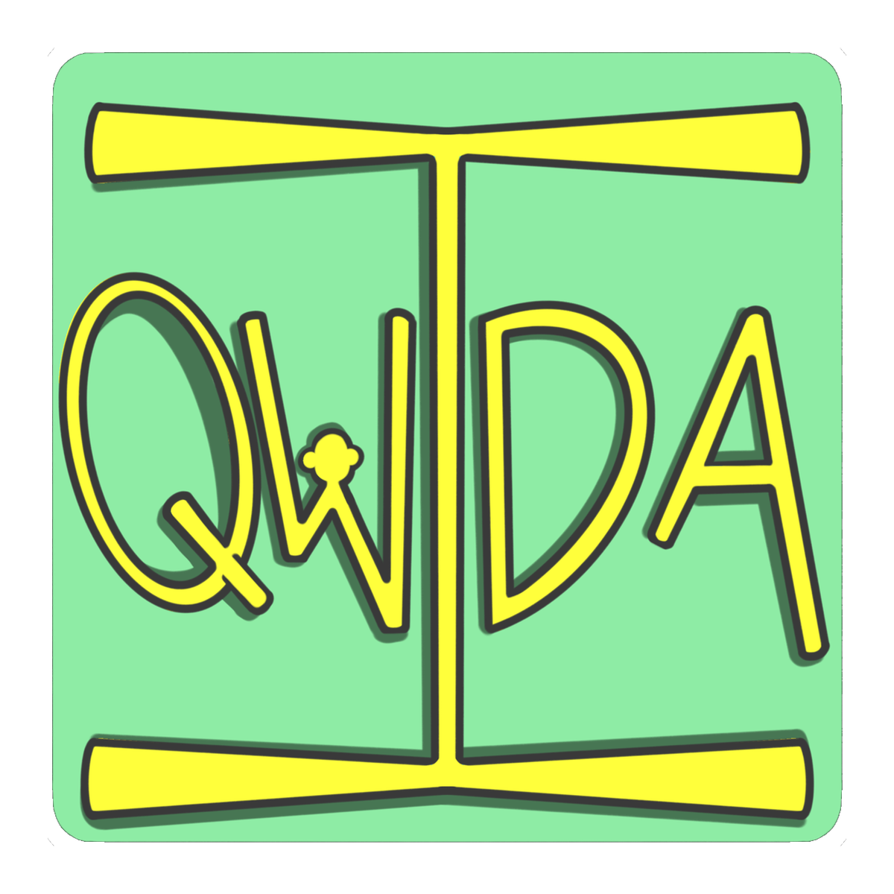
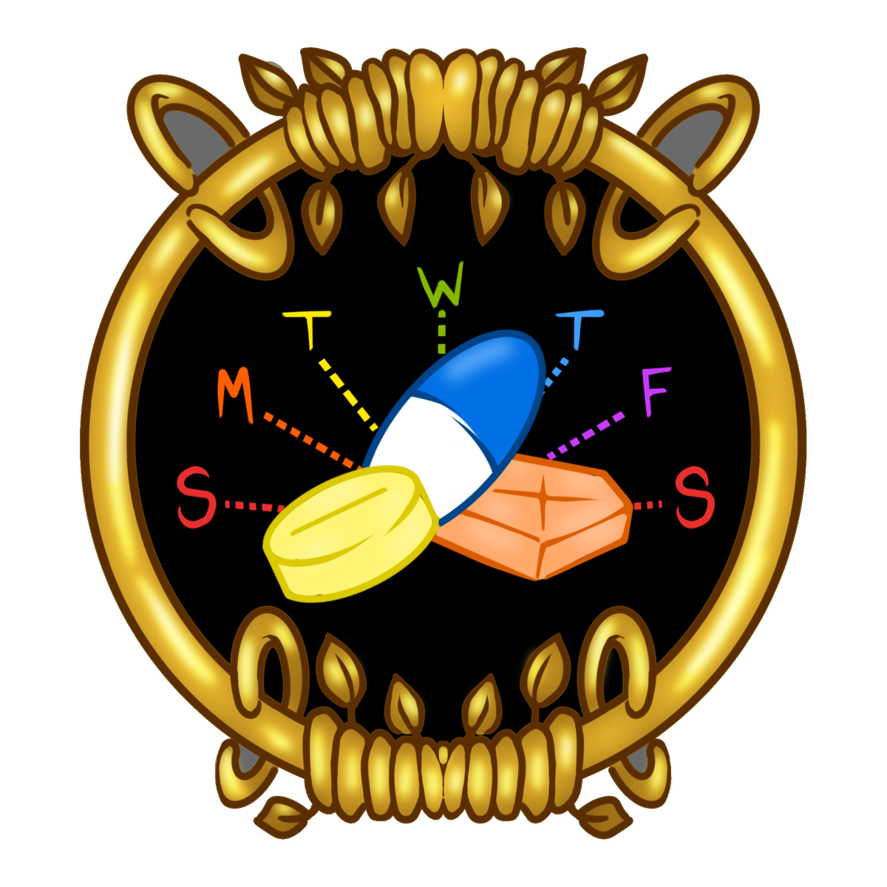

# Qwida

Qwida is a Spanish first web app (PWA) for Puerto Rican families caring for an elder. The elder
talks or takes a photo; her family, on the island or in the States, reviews and approves what
changed; the elder gets back one simple card of what to do. A fixed safety Fence runs before any
AI: Qwida never diagnoses and never changes medication, and emergencies point to 911.

Built for the Caribbean AI Summit Healthcare Hackathon, Puerto Rico, October 2026.

## Datos sintéticos

Every person, doctor, pharmacy, plan and recording in this repo is fictional. The demo case is
Doña Carmen Rivera (78, Adjuntas) and her daughter Marisol (Orlando). No real health information.

## Run it

```bash
npm i
npm run dev
```

Open http://localhost:3000 and choose Paciente or Familia. "Reiniciar demo" reloads the
synthetic case. Live demo: https://qwida.vercel.app

On a fresh clone, run `npm run dev` once before `npx tsc --noEmit`: Next.js generates
`next-env.d.ts` and the route types on first start.

```bash
npm test        # vitest unit tests
npm run e2e     # playwright, needs E2E_BASE_URL
```

| Variable | Default | Meaning |
|---|---|---|
| `QUIDA_STORE` | `mock` | Shared state backend. `mock` keeps events in server memory. |
| `KV_REST_API_URL`, `KV_REST_API_TOKEN` | unset | Upstash Redis via the Vercel Marketplace, shared state across phones in production. |
| `AI_GATEWAY_API_KEY` | unset | Vercel AI Gateway key, optional locally. Without it, AI routes return labeled `SIMULADO` fixtures. |
| `OPENAI_API_KEY` | unset | Optional production fallback. Every AI call tries the AI Gateway first, then OpenAI direct with this key, then the `SIMULADO` fixture. `OPENAI_TEXT_MODEL` (default `gpt-4o`) and `OPENAI_TRANSCRIBE_MODEL` (default `gpt-4o-transcribe`) pick the OpenAI models. |
| `TWILIO_ACCOUNT_SID`, `TWILIO_AUTH_TOKEN`, `TWILIO_PHONE_NUMBER` | unset | Optional. The voice call reminder stays `SIMULADO` without them. |
| `E2E_BASE_URL` | unset | Base URL for `npm run e2e`. |

## Real vs simulated

| Status | What |
|---|---|
| REAL | Consent gated visit capture, the Fence, photo trust rules, the human confirmation gate, week card approve and send, shared state across phones, provider directory (public data via MedSeek PR, frozen ORCPS fallback), referido 90 day countdown, `.ics` export, PWA. |
| SIMULADO (labeled) | Transcription and photo reading fall back to fixtures when the AI Gateway is unavailable, digest interval, voice call reminder, notification channel. |
| ROADMAP | Live audio check in, GPS arrival, provider portal, WhatsApp bridge, on device inference. |

## Made by people

Every image in the app is hand drawn by **Yari** in Procreate: the Qwida logo, the four patient
buttons (Hablar, Foto, Grabar mi cita, Mi tarjeta), the phone mock and the pill dial. Copies sized
for slides are in [`docs/art/`](docs/art/); the app's own files are in `public/art/`. No image in
Qwida was generated by AI. The pitch deck was built by hand in Canva by **Heather Xu**, with support
art by Yari.

Coding agents wrote much of the code under human review. Every model, session and token they used
during the hackathon is public at [`/ledger`](https://qwida.vercel.app/ledger).

<p>
  
  
  
  
  
  
</p>

## Layout

- `app/` routes: `/` role chooser, `/paciente`, `/familia`, `app/api/*` route handlers
- `lib/store/` `EventStore` interface and the in memory `MockStore`
- `lib/seed/` the synthetic case
- `lib/fence/` the deterministic safety tripwire and its fixed copy
- `components/ui/` shared badges, buttons and Fence notices
- `docs/BUILDLOG.md` one line per finished task
- `docs/art/` Yari's hand drawn art, sized for slides

License: MIT
